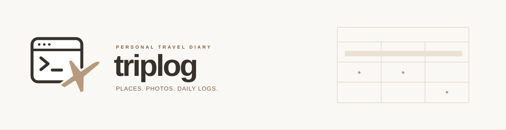

  

  <strong>장소와 사진, 하루의 기록을 하나의 다이어리에.</strong>

  
  
  

  <a href="./docs/PRD.md">기획서</a> ·
  <a href="https://github.com/JIHYE0705/triplog/issues/12">개발 진행표</a> ·
  <a href="https://github.com/JIHYE0705/triplog/pull/13">Codex 인수인계 PR</a> ·
  <a href="https://triplog-diary-jihye.selectbread.chatgpt.site">디자인 시안</a>

---

## 여행 기록을 쌓는 방식

**triplog**는 다녀온 장소에 사진과 소감을 남기고, 하루의 일기를 쓰는 개인 여행 다이어리입니다.

달력에서는 여행 기간을 확인하고, 주간에서는 한 주의 방문 기록을 훑고, 일간에서는 사진과 글을 자세히 읽고 씁니다. 기록이 쌓이면 지도에도 방문한 장소가 함께 쌓입니다.

한 여행에서 남긴 기록을 날짜별로, 여행별로, 기간별로 다시 찾아볼 수 있도록 만듭니다.

## 하나의 기록, 다섯 가지 보기

| 보기 | 무엇을 보나요? |
| :--- | :--- |
| **월간** | 여행 기간이 이어지는 달력과 기록한 날짜 |
| **주간** | 펼친 종이 다이어리처럼 한눈에 들어오는 **일주일 전체** |
| **일간** | 하루 여러 방문 장소, 큰 사진, 장소별 소감과 하루 일기 |
| **여행** | 하나의 여행에 속한 날짜별 기록과 사진 |
| **지도** | 방문한 장소의 사진 핀과 같은 장소의 재방문 이력 |

월간·주간·일간은 같은 기록을 서로 다른 범위로 보여줍니다. 화면마다 다시 작성할 필요가 없도록 설계합니다.

## 기록은 간단하게

1. **여행 만들기** — 제목과 기간을 정합니다.
2. **장소 남기기** — 하루에 여러 장소를 추가하고 순서를 정합니다.
3. **사진과 소감 붙이기** — 장소마다 사진과 짧은 글을 남깁니다.
4. **하루 일기 쓰기** — 하루 전체의 이야기를 따로 정리합니다.
5. **다시 보기** — 달력과 여행 앨범, 지도에서 기록을 찾아봅니다.

방문 시간은 선택 입력입니다. 같은 장소를 다시 방문하면 그날의 기록을 새로 남길 수 있습니다.

## 디자인 원칙

**정갈한 여행 수첩.** 흰 바탕, 읽기 쉬운 고딕체, 얇은 구분선과 절제된 파란색을 사용합니다. 사진과 글이 화면의 중심이 됩니다.

- **월간은 기간 중심.** 여행 띠는 옅은 가로 면으로 연결하며 왼쪽 강조 세로선을 사용하지 않습니다.
- **주간은 한 주 전체.** 7일 고정 칸에 장소·시간·작은 사진을 담고, 초과 기록은 일간으로 연결합니다.
- **일간은 자세하게.** 큰 사진과 충분한 글 공간을 제공합니다.
- **로고는 터미널과 비행기.** 개발자 터미널 앞을 비행기가 가로지르는 형태로 여행과 로그를 표현합니다.

이 README의 헤더는 로고 콘셉트를 반영한 문서용 SVG입니다.

## 현재 상태

**기획과 인터랙티브 디자인 시안을 준비한 단계입니다.** 이 저장소의 문서와 이슈는 실제 앱 개발의 기준이며, 아래 기능은 아직 운영 구현이 완료되지 않았습니다.

| 항목 | 현황 |
| :--- | :--- |
| 제품 기획 | [PRD v1.0](./docs/PRD.md) 작성 |
| 작업 관리 | [이슈 #1–#12](https://github.com/JIHYE0705/triplog/issues/12) 등록 |
| 디자인 시안 | 월간·주간·일간·여행·지도 흐름 검토 |
| 실제 기록·사진 저장 | 개발 예정 |
| Google Maps 장소 검색·사진 지도 | 개발 예정 |
| Vercel 배포 | 운영 방향으로 검토 중 |

[시안 열기 ↗](https://triplog-diary-jihye.selectbread.chatgpt.site)

시안은 소유자 ChatGPT 로그인이 필요합니다. 가상 여행 데이터, 브라우저 로컬 저장과 가상 지도 배치로 구성되어 있습니다. 서버 동기화·실제 Google Maps·백업 기능은 연결 전이며, 주간 화면 잘림은 [우선 개선 항목 #3](https://github.com/JIHYE0705/triplog/issues/3)입니다. 실제 여행 기록의 보관 용도로 사용하기 전 서버 저장과 복구 기능을 구현합니다.

## 개발 로드맵

| 단계 | 작업 | 이슈 |
| :--- | :--- | :--- |
| **01 · 기반** | 기술·정책 결정, 인증·데이터 모델, 주간 UI 개선 | [#1](https://github.com/JIHYE0705/triplog/issues/1) · [#2](https://github.com/JIHYE0705/triplog/issues/2) · [#3](https://github.com/JIHYE0705/triplog/issues/3) |
| **02 · 기록** | 여행 관리, 여러 방문·일기, 월간 연동 | [#4](https://github.com/JIHYE0705/triplog/issues/4) · [#5](https://github.com/JIHYE0705/triplog/issues/5) · [#6](https://github.com/JIHYE0705/triplog/issues/6) |
| **03 · 사진과 지도** | 비공개 사진 업로드, 장소 검색·사진 지도 | [#7](https://github.com/JIHYE0705/triplog/issues/7) · [#8](https://github.com/JIHYE0705/triplog/issues/8) |
| **04 · 안정화** | 자동 저장·초안 복구, 휴지통·내보내기·복원 | [#9](https://github.com/JIHYE0705/triplog/issues/9) · [#10](https://github.com/JIHYE0705/triplog/issues/10) |
| **05 · 운영** | 배포, 통합 검증과 운영 문서 | [#11](https://github.com/JIHYE0705/triplog/issues/11) |

진행 상황과 선행 작업은 [전체 체크리스트 #12](https://github.com/JIHYE0705/triplog/issues/12)에서 관리합니다.

공유 링크와 동행자 공동 기록은 후속 검토 대상입니다. 캘린더 연동·네이티브 앱·실시간 이동 추적은 1차 범위에 포함하지 않습니다. 기존 트리플 기록 이관은 결정 전입니다.

## 기술과 실행 환경

| 영역 | 방향 |
| :--- | :--- |
| 소스 관리 | GitHub |
| 웹앱 배포 | Vercel 우선 검토 |
| 프레임워크 | 미정 |
| 인증·DB·사진 저장소 | 미정 |
| 지도 | Google Maps 연동 예정 |

구체적인 선택과 비용·사진 정책은 [#1](https://github.com/JIHYE0705/triplog/issues/1)에서 결정합니다. 실제 프로젝트 초기화 이후 설치·실행·테스트 명령과 환경변수 예시를 추가합니다.

## 개발에 참여하거나 AI로 이어서 작업한다면

1. [기획서](./docs/PRD.md)와 [진행표 #12](https://github.com/JIHYE0705/triplog/issues/12)를 읽습니다.
2. [Codex 인수인계 PR #13](https://github.com/JIHYE0705/triplog/pull/13)의 문서와 최신 반영 상태를 확인합니다.
3. 해당 이슈의 작업 범위와 완료 조건을 확인하고 작업 브랜치를 만듭니다.
4. 변경한 동작을 검증한 뒤 PR을 올립니다.

**main에 직접 푸시하지 않습니다. 문서 수정도 작업 브랜치 → PR로 진행합니다.**

브랜치 보호 규칙의 실제 적용 여부는 별도 확인이 필요합니다. 규칙 설정 여부와 관계없이 위 작업 방식을 따릅니다.

<strong>기록을 오래 보관하기 위한 기준</strong>

- 개인 계정만 접근하고 서버에서 데이터와 사진의 소유권을 검증합니다.
- 사진 저장소는 비공개를 기본으로 합니다.
- 사진 원본·개인 일기·실제 위치 기록·비밀키는 저장소에 커밋하지 않습니다.
- 자동 저장 실패를 성공으로 표시하지 않고 초안 복구와 재시도를 제공합니다.
- 기록과 사진을 함께 내보내고 실제 복원으로 백업을 검증합니다.
- 서버·DB·사진·지도 사용량을 구분해 운영 비용을 관리합니다.

---

triplog · 개인 여행 기록 프로젝트

