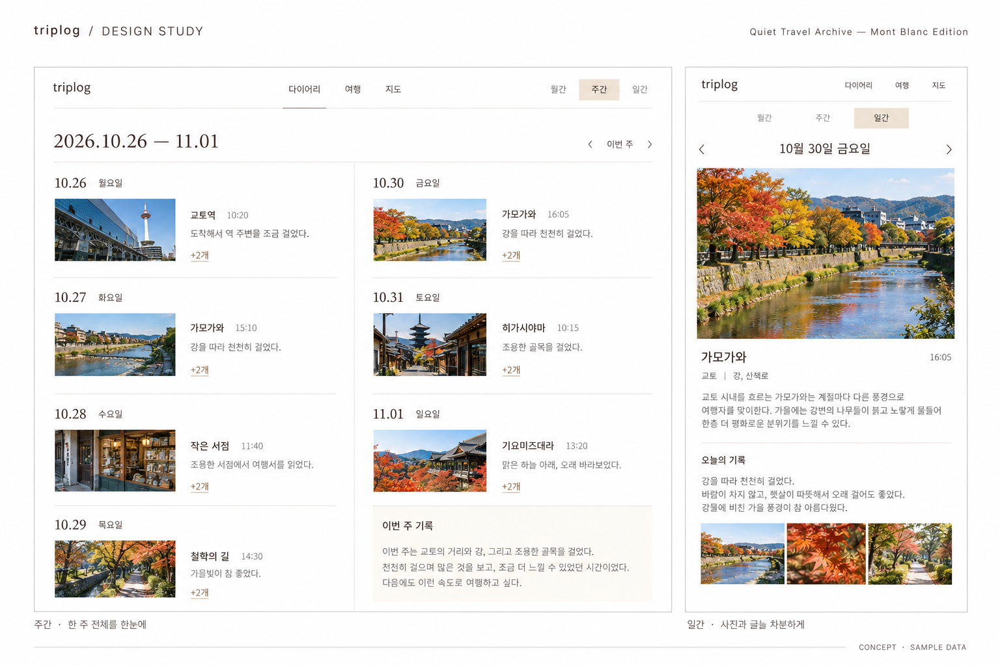

<h1 align="center">triplog</h1>

<p align="center">날짜 · 장소 · 사진 · 일기를 연결하는 개인 비공개 여행 아카이브</p>
<p align="center"><sub>Quiet Travel Archive — Mont Blanc Edition</sub></p>

<p align="center">
  <a href="./docs/PRD.md">기획서</a> ·
  <a href="./docs/design/DESIGN_SYSTEM.md">디자인 시스템</a> ·
  <a href="./docs/design/README_CONCEPT.md">디자인 시안</a> ·
  <a href="https://github.com/JIHYE0705/triplog/issues/12">개발 진행표</a>
</p>

## 디자인 미리보기



**새 디자인 기준으로 만든 정적 제안이며, 현재 앱의 스크린샷이 아닙니다.** 가상 기록과 AI 생성 사진을 사용했습니다. 이미지 속 글꼴은 SUIT의 실제 적용·로딩 결과가 아닙니다. 실제 앱은 자체 호스팅 SUIT를 사용하며, 새 토큰 적용과 반응형·접근성 검증은 후속 UI 작업에서 진행합니다.

주간은 한 주를 훑고, 일간은 사진과 글을 읽는 데 집중합니다. [시안 설명과 검토 항목](./docs/design/README_CONCEPT.md)을 함께 봐 주세요. 기존 로고·아이콘·문서용 SVG는 보존합니다.

## triplog가 담는 기록

다녀온 장소마다 사진과 소감을 남기고 하루 전체의 일기를 씁니다. 같은 기록을 날짜·여행·장소로 다시 찾아보는 것이 목표입니다. 아이폰에서 기록하고 맥 브라우저에서 긴 글과 사진을 정리하는 모바일 우선 웹앱·PWA로 만듭니다.

| 보기 | 역할 |
| --- | --- |
| 월간 | 여행 기간을 옅은 가로 띠로 연결하고 기록한 날짜 찾기 |
| 주간 | **7일 전체**에서 장소·선택 시간·작은 사진 훑기. 초과 기록은 `+N개`로 일간 연결 |
| 일간 | 큰 사진·장소별 소감·하루 일기를 구분해 읽고 쓰기 |
| 여행 | 여행의 기간·사진·날짜별 기록 모아보기 |
| 지도 | 방문 장소의 사진 핀과 재방문 이력에서 일간 찾기 |

월간·주간·일간은 같은 원본 기록을 다르게 보여줍니다. 방문 시간은 선택 입력이며 같은 장소의 재방문도 각각 남깁니다. 위 표는 제품의 목표 범위로, 현재 구현 상태는 아래와 구분합니다.

## 디자인 기준

**흰 바탕 위에 사진과 글을 두고, 몽블랑 크림은 필요한 곳에만 사용합니다.** 상세 토큰의 단일 기준은 [디자인 시스템](./docs/design/DESIGN_SYSTEM.md)이며 아래는 승인된 핵심 팔레트의 요약입니다.

| 역할 | 토큰 | 색상 |
| --- | --- | --- |
| 기본 바탕 | Paper White · `bg-primary` | `#FFFFFF` |
| 강조 면 | Mont Blanc Cream · `accent-primary` | `#E9DDC7` |
| 옅은 선택 면 | Soft Ivory · `accent-soft` | `#F8F3E9` |
| 활성 요소·강조 글자 | Chestnut Brown · `accent-strong` | `#79634F` |
| 제목·본문 | Warm Ink · `text-primary` | `#302B27` |

- **타이포그래피:** SUIT 단일 패밀리. 본문 400, 제목·선택 500, 필요한 강조만 600. 기본 본문은 16px로 읽기 쉽게 유지합니다.
- **구성:** 얇은 선과 절제된 여백. 반복되는 베이지 카드·과한 그림자·장식 대신 사진과 기록에 위계를 줍니다. 사진 본래 색을 유지합니다.
- **탐색:** 다이어리·여행·지도. 월간 기간 띠에는 왼쪽 세로선을 넣지 않고, 주간에서는 마지막 날짜와 `+N개` 접근을 보장합니다.
- **상태와 대비:** 크림 면에는 Warm Ink 글자를 씁니다. 선택은 색과 함께 밑줄·형태로 구별하고, 저장 중·실패·초안 상태를 명확히 알립니다.
- **브랜드:** 소문자 `triplog`와 기존 개발자 터미널·비행기 콘셉트를 보존합니다. [기존 문서용 헤더](./docs/assets/readme-header.svg)는 이전 팔레트의 참고 에셋이며 최종 로고 원본이 아닙니다.

이전 밤크림 HEX보다 위 최신 토큰을 우선합니다. 승인 이력은 [디자인 결정](./docs/design/DECISIONS.md)에 있습니다. 주 시작 요일과 [세로형 위클리 #22](https://github.com/JIHYE0705/triplog/issues/22)는 미결정이며, 이번 시안은 현행 월요일 시작·두 열 구성을 유지합니다.

## 현재 구현 상태

**조회용 샘플 앱입니다.** 실제 여행 기록을 작성·저장하는 용도로 사용할 수 없습니다. Supabase 연결만 구성하며 로그인·계정 관리는 후속 작업으로 미뤘습니다.

| 구분 | 상태 |
| --- | --- |
| 앱 기반 | Next.js·세 메뉴·SUIT 자체 호스팅·기존 팔레트 구성 |
| 주간·일간 | 7일 전체 보기·주 이동·가용 높이에 따른 `+N개`·일간 전체 방문/일기 조회 |
| 여행·지도 | 기능 안내 화면. 실제 데이터·지도 연결 전 |
| 새 디자인 | 시스템 문서와 이번 정적 시안. 실제 앱 토큰 적용 전 |
| PWA | manifest·아이콘·standalone 메타데이터 구성. 아이폰 설치 미검증 |
| 자동 검사 | 린트·타입 검사·빌드·기본 HTTP 테스트 구성 |
| Supabase | 서울 전용 개발 프로젝트·서버 클라이언트·읽기 전용 연결 검사 구성 |
| 데이터 모델 | 여행·하루 일기·장소·방문·동행자·이동편·사진 메타데이터 관계 구성. 앱 접근은 차단 |
| 실제 저장·사진·기기 간 동기화 | 개발 예정 |
| 로그인·계정 관리 | 후속 작업으로 보류 |
| 배포 | 운영 환경 검증 전 |

첫 화면은 2026년 10월 26일~11월 1일의 가상 기록입니다. 사진이 없는 날·긴 장소명·많은 방문도 포함하며 날짜를 누르면 일간으로 이동합니다. 예시 사진의 출처는 [샘플 사진 안내](./public/demo/README.md)를 따릅니다.

여행 없는 일상 기록과 같은 날 여러 여행 연결을 허용하는 정책을 확정했습니다. [기록 데이터 모델](./docs/DATA_MODEL.md)에 관계·현지 날짜·제약과 실제 DB 검증 방법을 정리했습니다. 화면에서 실제 기록을 작성·조회하는 기능은 아직 연결하지 않았습니다.

[이전 인터랙티브 시안](https://triplog-diary-jihye.selectbread.chatgpt.site)은 새 정적 시안·저장소 앱과 별개입니다. 소유자 ChatGPT 로그인이 필요하며 가상 데이터·브라우저 로컬 저장·가상 지도 배치로 구성되어 있습니다. 서버 저장·실제 Google Maps·백업 완료를 뜻하지 않습니다.

## 앞으로의 작업

| 영역 | 관련 이슈 |
| --- | --- |
| 운영 정책·인증·데이터 기반 | [#1](https://github.com/JIHYE0705/triplog/issues/1) · [#2](https://github.com/JIHYE0705/triplog/issues/2) |
| 여행·방문·일기·월간 연동 | [#4](https://github.com/JIHYE0705/triplog/issues/4) · [#5](https://github.com/JIHYE0705/triplog/issues/5) · [#6](https://github.com/JIHYE0705/triplog/issues/6) |
| 사진·지도 | [#7](https://github.com/JIHYE0705/triplog/issues/7) · [#8](https://github.com/JIHYE0705/triplog/issues/8) |
| 자동 저장·초안·복구·내보내기 | [#9](https://github.com/JIHYE0705/triplog/issues/9) · [#10](https://github.com/JIHYE0705/triplog/issues/10) |
| 배포·운영 검증 | [#11](https://github.com/JIHYE0705/triplog/issues/11) |
| 차기 주간 배치 비교·이동편 | [#22](https://github.com/JIHYE0705/triplog/issues/22) · [#23](https://github.com/JIHYE0705/triplog/issues/23) |

완료·진행 상태와 선행 작업은 [진행표 #12](https://github.com/JIHYE0705/triplog/issues/12)에서 관리합니다. 실제 기록과 사진은 비공개 서버 저장을 기본으로 하고, 자동 저장 실패 안내·초안 복구·사진을 포함한 내보내기와 실제 복원을 갖출 예정입니다.

1차는 온라인 사용을 기본으로 합니다. 네이티브 앱·App Store 배포·실시간 위치 추적·완전한 오프라인 사용·백그라운드 사진 업로드는 포함하지 않습니다. 공유와 공동 기록은 후속 검토, 기존 트리플 기록 이관은 결정 전입니다.

## 개발 환경과 실행

Next.js 16 App Router · React 19 · TypeScript · Tailwind CSS 4 · SUIT Variable 자체 호스팅을 사용합니다. Node.js 24 LTS(`.nvmrc`)와 npm 11.17.0이 기준이며 의존성은 `package-lock.json`에 고정합니다.

```sh
npm ci
npm run dev
```

기본 주소는 `http://localhost:3000`입니다. 포트가 사용 중이면 터미널에 표시된 주소를 확인합니다. 샘플 앱은 외부 서비스 환경변수 없이 실행할 수 있습니다. Supabase 연결 검사는 `.env.local`에 전용 프로젝트 URL·publishable key를 설정한 뒤 `npm run check:supabase`로 실행합니다. [연결 안내](./docs/SUPABASE_SETUP.md)를 따르고 실제 환경 파일은 커밋하지 않습니다.

```sh
npm run lint
npm run typecheck
npm test
npm start
```

`npm test`는 프로덕션 빌드 후 날짜·주 경계·노출 개수 계산과 임시 서버의 메뉴·PWA·404·주간/일간 연결을 검사합니다. `npm start`는 빌드 결과를 실행합니다. PR의 `App checks`가 설치·린트·타입 검사·빌드·테스트를 실행하며, main 보호 규칙의 실제 연결 여부는 별도 확인이 필요합니다.

샘플 데이터는 [demo-diary.ts](./lib/demo-diary.ts), 사진 출처·이용 기준은 [샘플 사진 안내](./public/demo/README.md), 폰트 출처·라이선스는 [폰트 안내](./app/fonts/README.md)에 있습니다. `?week=2026-11-01`처럼 날짜를 지정하면 해당 날짜가 포함된 주를 엽니다.

PWA manifest와 아이콘은 구성돼 있습니다. 기존 코드 기반 아이콘은 최종 로고 원본이 아니며, 아이폰 홈 화면 추가·standalone 실행은 HTTPS 배포 후 실기기로 확인해야 합니다. 서비스 워커·오프라인 캐시·알림은 구성하지 않았습니다.

DB는 차곡과 분리한 서울 Supabase 개발 프로젝트 `triplog-dev`에 연결합니다. 로그인·계정 관리·소유권 검증과 실제 기록·사진 저장은 후속 작업입니다. 지도는 Google Maps, 웹 배포는 Vercel을 기준으로 검토합니다. 비용과 운영 정책은 [개발 결정](./docs/DECISIONS.md) 및 [#1](https://github.com/JIHYE0705/triplog/issues/1)에서 관리합니다.

## 이어서 작업하기

[기획서](./docs/PRD.md) → [디자인 시스템](./docs/design/DESIGN_SYSTEM.md)·[디자인 결정](./docs/design/DECISIONS.md) → [개발 결정](./docs/DECISIONS.md)·[인수인계](./docs/CODEX_HANDOFF.md) → 해당 이슈와 [진행표](https://github.com/JIHYE0705/triplog/issues/12)를 확인합니다.

최신 main에서 작업 브랜치를 만들고 검증 후 기존 라벨을 붙인 PR을 올립니다. **문서 변경도 PR로 진행하고, 머지는 사용자가 합니다.** 개인정보·실제 일기·위치 기록·비밀키는 커밋하지 않습니다. 신규 화면과 대규모 디자인 변경은 시안을 비교·승인한 뒤 구현합니다.
