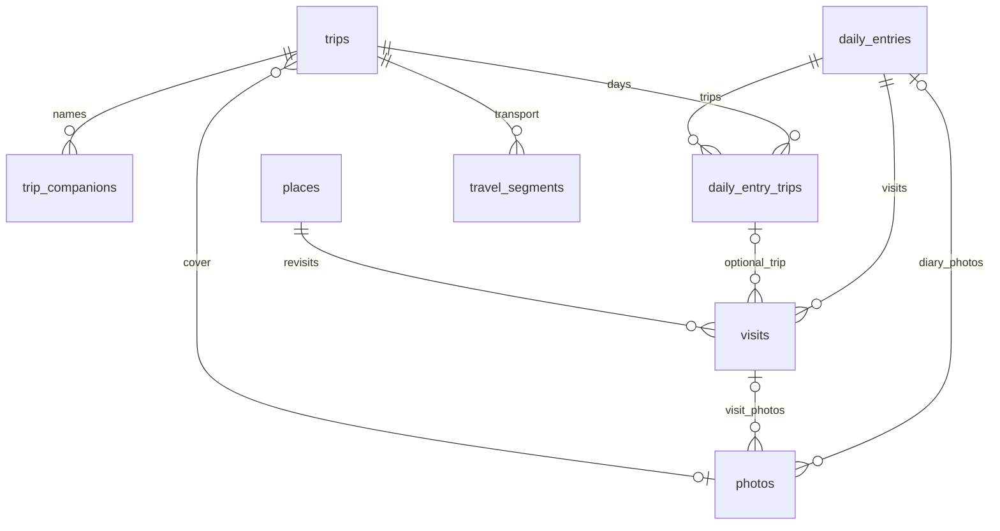

# 기록 데이터 모델

## 현재 범위

triplog 전용 개발 DB `triplog-dev` (`htnaiayvvovgkcnsipzh`)의 초기 모델이다. 로그인·계정 관리는 보류하며 화면은 계속 샘플 데이터를 사용한다. 실제 기록 작성 API·사진 업로드·외부 API는 아직 연결하지 않는다.

2026-11-01 사용자 결정으로 여행 없는 일상 기록과 같은 날 여러 여행 연결을 허용한다. 장소와 방문을 분리하고, 날짜만으로 여행을 자동 지정하지 않는다.

## 테이블과 관계

| 테이블 | 역할과 제약 |
| --- | --- |
| `trips` | 소유자·제목·현지 시작/종료일·선택적 대표 사진. 종료일은 시작일 이상 |
| `trip_companions` | 여행별 이름·순서. 계정 연결 없이 여러 이름을 저장하며 동명이인도 허용 |
| `daily_entries` | 소유자·현지 날짜당 하루 일기 하나. 장소·여행 없이도 생성 가능 |
| `daily_entry_trips` | 하루 일기와 여행의 다대다 관계. 여행에 연결하지 않은 날도 허용 |
| `places` | 소유자 범위의 장소명·선택적 위경도. 좌표는 둘 다 입력하거나 둘 다 생략 |
| `visits` | 하루 일기·장소·선택적 여행·선택적 현지 시간/시간대·소감·순서. 같은 장소 재방문은 별도 방문 |
| `photos` | 방문 또는 하루 일기 중 한 곳에 연결하는 객체 키·순서·처리 상태·대표 여부. 실제 파일 저장은 후속 |
| `travel_segments` | 여행의 항공/철도 구간·운영사·편명/열차번호·출발/도착 지점·각 현지 시각/시간대·순서 |

소유자는 기존 Supabase `auth.users.id`를 참조한다. 별도 프로필·계정 테이블은 추가하지 않는다. 부모/자식의 `(owner_id, id)` 복합 외래 키로 다른 소유자의 여행·일기·장소·방문·사진을 연결하지 못하게 한다.

방문의 날짜는 연결된 `daily_entries.local_date`를 사용해 중복 날짜 불일치를 피한다. 방문에서 여행을 선택하면 해당 하루와 여행의 `daily_entry_trips` 연결이 먼저 있어야 한다. 하루에 여러 여행을 연결해도 방문 하나는 여행 하나만 선택한다.



## 날짜·순서·사진·삭제

- 하루 날짜는 `date`, 방문 시간은 `time without time zone`과 PostgreSQL이 아는 시간대 이름으로 저장한다. 시간이 없으면 시간대도 생략한다. `24:00`은 다음 날 `00:00`으로 입력해야 한다.
- 이동편은 출발/도착 각각 `timestamp without time zone`과 시간대를 보관하고 실제 시각으로 비교한다. 도착 현지 날짜가 출발보다 전날이어도 실제 도착이 출발 이후면 저장 가능하다. DST 전환의 중복/존재하지 않는 현지 시각을 사용자가 고르는 흐름은 이동편 입력 기능에서 검토한다.
- 여행 기간 밖 일기·방문·이동편도 보존한다. 기간을 바꿔도 연결을 자동 삭제하지 않으며, 이후 화면에서 범위 밖 상태를 안내한다.
- 위치 없는 장소와 시간·사진 없는 방문을 허용한다. 장소명·좌표만으로 자동 병합하지 않는다. 외부 장소 ID·출처·캐시 정책은 #8 연동에서 추가한다.
- 방문·동행자·이동편은 부모 안에서 순서가 중복되지 않는다. 해당 고유 제약은 지연 검사가 가능하므로 순서 교환 시 한 트랜잭션에서 제약을 지연할 수 있다. 사진은 부모별 부분 고유 인덱스를 사용하며 실제 재정렬 트랜잭션은 #7에서 구현한다.
- 사진은 `pending | ready | failed` 메타데이터만 저장한다. 방문/하루 중 정확히 하나에 연결하고, 부모당 대표 사진 하나만 허용한다. 대표 여부는 `ready`일 때만 가능하다. 여행의 대표 사진은 같은 소유자의 사진만 참조하며, 실제 선택 API에서 준비 완료·파일 존재 여부를 확인해야 한다.
- 외래 키는 삭제를 전파하지 않는다. 연결된 기록을 실수로 삭제할 수 없으며 휴지통·복구·영구 삭제 절차는 #10에서 구현한다.
- `daily_entries.version`은 양수 버전 필드다. 현재는 작성 API가 없으며 자동 증가·낙관적 동시 수정 검사는 #9의 저장 흐름에서 함께 구현한다.

## 인증 보류 중 접근 정책

모든 기록 테이블에 RLS를 켜고 `PUBLIC`·`anon`·`authenticated`의 테이블 권한을 회수한다. 허용 정책은 아직 만들지 않아 로그인 유무와 관계없이 앱에서 읽거나 쓸 수 없다. 임시 공개 저장·service_role 우회 API는 추가하지 않는다. [공식 RLS 기준](https://supabase.com/docs/guides/database/postgres/row-level-security)을 따른다.

`private.is_known_time_zone(text)`는 시스템 시간대 목록을 확인하는 `SECURITY INVOKER` 검사 함수다. 앱 역할 실행 권한도 회수한다. 실제 저장을 연결할 때는 이 함수의 필요한 권한, 서버 인증, 소유권 RLS 및 비공개 사진 검증을 함께 구성해야 한다. 이번 역할 차단 검사는 향후 소유자별 RLS 검증을 대신하지 않는다.

## 마이그레이션과 실제 DB 검사

기존 원격 이력은 `supabase migration fetch`로 복원했다. 원격 버전은 `20261031074132_app_access.sql`이며, 보류한 로컬 인증 작업의 `20261031073934`와 다르다. 인증 기능을 재개한 것이 아니라 이미 적용된 이력을 그대로 보존한 것이다.

```sh
# 대상 ref와 예상 마이그레이션을 먼저 확인한다.
npx supabase@2.122.0 db push --project-ref htnaiayvvovgkcnsipzh --dry-run --skip-vault
npx supabase@2.122.0 db push --project-ref htnaiayvvovgkcnsipzh --skip-vault
npm run test:db
```

실제 개발 DB 검사는 Supabase CLI 인증이 필요하며 운영 DB를 대상으로 하지 않는다. SQL은 두 가상 소유자와 기록을 트랜잭션 안에서 만들고 모두 롤백한다. 일상 기록·같은 날 복수 여행·재방문·시간대·여행 기간 변경 시 보존·타 소유자 연결 거부·제약 오류·앱 역할 차단을 확인한다. 실제 로그인·앱 작성·파일 업로드 성공을 뜻하지 않는다.

GitHub CI는 실제 DB 검사를 실행하지 않는다. PR에는 로컬 실제 DB 결과와 CI 앱 검사 결과를 구분해 기록한다.

DB Advisor의 [RLS 정책 없음 INFO](https://supabase.com/docs/guides/database/database-linter?lint=0008_rls_enabled_no_policy)는 현재의 앱 접근 차단 상태다. 기존 인증 함수 `has_app_access()`의 [SECURITY DEFINER 실행 권한 WARN](https://supabase.com/docs/guides/database/database-linter?lint=0029_authenticated_security_definer_function_executable)은 원격 이력에서 유지되며 인증 재개 시 검토한다. 새 모델의 복합 외래 키는 커버 인덱스를 구성한다. 초기 미사용 인덱스 INFO는 실제 앱 조회가 아직 없어서 발생하며 접근 패턴을 연결할 때 재검토한다.
